# CẨM NANG HƯỚNG DẪN SỬ DỤNG HỆ THỐNG MBF RISK MONITOR
### HỆ THỐNG QUẢN LÝ HỒ SƠ RỦI RO TRỌNG YẾU TỔNG CÔNG TY VIỄN THÔNG MOBIFONE

---

> [!NOTE]
> **Tài liệu ban hành nội bộ**: Dành cho Cán bộ Lãnh đạo, Ban Quản lý rủi ro (Ban 4), Cán bộ phụ trách quản lý rủi ro tại các Ban chức năng / Trung tâm / Chi nhánh thuộc Tổng công ty Viễn thông MobiFone, và Quản trị viên hệ thống.

---

## MỤC LỤC TỔNG QUAN

1. [PHẦN I: TỔNG QUAN HỆ THỐNG & ĐĂNG NHẬP BAN ĐẦU](#phần-i-tổng-quan-hệ-thống--đăng-nhập-ban-đầu)
   - [1.1. Giới thiệu hệ thống MBF Risk Monitor](#11-giới-thiệu-hệ-thống-mbf-risk-monitor)
   - [1.2. Các nhóm vai trò người dùng trong hệ thống](#12-các-nhóm-vai-trò-người-dùng-trong-hệ-thống)
   - [1.3. Hướng dẫn Đăng nhập](#13-hướng-dẫn-đăng-nhập)
   - [1.4. Đổi mật khẩu lần đầu và bảo mật tài khoản](#14-đổi-mật-khẩu-lần-đầu-và-bảo-mật-tài-khoản)
   - [1.5. Cấu trúc giao diện chính & Chuyển đổi Chu kỳ năm](#15-cấu-trúc-giao-diện-chính--chuyển-đổi-chu-kỳ-năm)
2. [PHẦN II: HƯỚNG DẪN DÀNH CHO CÁN BỘ ĐƠN VỊ (UNIT)](#phần-ii-hướng-dẫn-dành-cho-cán-bộ-đơn-vị-unit)
   - [2.1. Xem danh sách rủi ro và nhiệm vụ thuộc đơn vị phụ trách](#21-xem-danh-sách-rủi-ro-và-nhiệm-vụ-thuộc-đơn-vị-phụ-trách)
   - [2.2. Nhập số liệu Chỉ số định lượng (KRI/KCI tự động tính vùng)](#22-nhập-số-liệu-chỉ-số-định-lượng-krikci-tự-động-tính-vùng)
   - [2.3. Nhập số liệu Chỉ số định tính (KRI/KCI thủ công)](#23-nhập-số-liệu-chỉ-số-định-tính-krikci-thủ-công)
   - [2.4. Cập nhật Tiến độ Đầu việc kế hoạch hành động](#24-cập-nhật-tiến-độ-đầu-việc-kế-hoạch-hành-động)
   - [2.5. Theo dõi lịch sử, Rút lại bản nộp và Sửa nộp lại bản bị từ chối](#25-theo-dõi-lịch-sử-rút-lại-bản-nộp-và-sửa-nộp-lại-bản-bị-từ-chối)
3. [PHẦN III: HƯỚNG DẪN DÀNH CHO BAN QUẢN LÝ RỦI RO (BAN 4)](#phần-iii-hướng-dẫn-dành-cho-ban-quản-lý-rủi-ro-ban-4)
   - [3.1. Theo dõi Tổng quan Dashboard và Ma trận nhiệt rủi ro (Heatmap 5x5)](#31-theo-dõi-tổng-quan-dashboard-và-ma-trận-nhiệt-rủi-ro-heatmap-5x5)
   - [3.2. Giám sát Chi tiết Hồ sơ rủi ro & Thiết lập Ngưỡng, Mục tiêu](#32-giám-sát-chi-tiết-hồ-sơ-rủi-ro--thiết-lập-ngưỡng-mục-tiêu)
   - [3.3. Phân công Đơn vị phụ trách cho Đầu việc và Chỉ số](#33-phân-công-đơn-vị-phụ-trách-cho-đầu-việc-và-chỉ-số)
   - [3.4. Theo dõi và Giám sát Hàng chờ duyệt số liệu](#34-theo-dõi-và-giám-sát-hàng-chờ-duyệt-số-liệu)
   - [3.5. Thực hiện Đánh giá Mức rủi ro còn lại (Residual Risk) theo Quý](#35-thực-hiện-đánh-giá-mức-rủi-ro-còn-lại-residual-risk-theo-quý)
   - [3.6. Xuất Báo cáo Tổng quan và Hồ sơ rủi ro Biểu mẫu BM06](#36-xuất-báo-cáo-tổng-quan-và-hồ-sơ-rủi-ro-biểu-mẫu-bm06)
4. [PHẦN IV: HƯỚNG DẪN DÀNH CHO QUẢN TRỊ VIÊN HỆ THỐNG (ADMIN)](#phần-iv-hướng-dẫn-dành-cho-quản-trị-viên-hệ-thống-admin)
   - [4.1. Phê duyệt và Từ chối số liệu nộp từ các Đơn vị](#41-phê-duyệt-và-từ-chối-số-liệu-nộp-từ-các-đơn-vị)
   - [4.2. Quản trị Chu kỳ rủi ro (Nhập Excel, Sao chép sang năm mới, Lưu trữ)](#42-quản-trị-chu-kỳ-rủi-ro-nhập-excel-sao-chép-sang-năm-mới-lưu-trữ)
   - [4.3. Quản trị Kỳ báo cáo (Tạo kỳ tự động, Tạo kỳ đợt, Khóa kỳ, Mở lại kỳ)](#43-quản-trị-kỳ-báo-cáo-tạo-kỳ-tự-động-tạo-kỳ-đợt-khóa-kỳ-mở-lại-kỳ)
   - [4.4. Quản lý Tài khoản người dùng và Phân quyền](#44-quản-lý-tài-khoản-người-dùng-và-phân-quyền)
   - [4.5. Cấu hình Tham số Cảnh báo hệ thống](#45-cấu-hình-tham-số-cảnh-báo-hệ-thống)
   - [4.6. Tra cứu Nhật ký kiểm toán (Audit Log) & So sánh Before/After](#46-tra-cứu-nhật-ký-kiểm-toán-audit-log--so-sánh-beforeafter)
5. [PHẦN V: HƯỚNG DẪN DÀNH CHO LÃNH ĐẠO & NGƯỜI XEM (VIEWER)](#phần-v-hướng-dẫn-dành-cho-lãnh-đạo--người-xem-viewer)
   - [5.1. Tra cứu và theo dõi trạng thái hồ sơ rủi ro toàn Tổng công ty](#51-tra-cứu-và-theo-dõi-trạng-thái-hồ-sơ-rủi-ro-toàn-tổng-công-ty)
   - [5.2. Xuất dữ liệu phục vụ họp giao ban và báo cáo điều hành](#52-xuất-dữ-liệu-phục-vụ-họp-giao-ban-và-báo-cáo-điều-hành)
6. [PHẦN VI: PHỤ LỤC & GIẢI QUYẾT SỰ CỐ THƯỜNG GẶP (FAQ)](#phần-vi-phụ-lục--giải-quyết-sự-cố-thường-gặp-faq)
   - [6.1. Bảng giải thích thuật ngữ và chữ viết tắt](#61-bảng-giải-thích-thuật-ngữ-và-chữ-viết-tắt)
   - [6.2. Câu hỏi thường gặp và cách xử lý](#62-câu-hỏi-thường-gặp-và-cách-xử-lý)
   - [6.3. Kênh liên hệ hỗ trợ kỹ thuật](#63-kênh-liên-hệ-hỗ-trợ-kỹ-thuật)

---

# PHẦN I: TỔNG QUAN HỆ THỐNG & ĐĂNG NHẬP BAN ĐẦU

## 1.1. Giới thiệu hệ thống MBF Risk Monitor

**MBF Risk Monitor** là nền tảng số hóa quản lý Hồ sơ rủi ro trọng yếu (HSRRTY) của Tổng công ty Viễn thông MobiFone. Hệ thống được phát triển nhằm chuẩn hóa và hiện đại hóa quy trình quản trị rủi ro doanh nghiệp:
- **Nhận diện & Đánh giá rủi ro**: Quản lý chi tiết từng hồ sơ rủi ro, phân tích các nguyên nhân gốc rễ (NN), mức độ ảnh hưởng (AH), các biện pháp kiểm soát hiện hữu (KS) và kế hoạch hành động giảm thiểu (KH).
- **Giám sát thời gian thực**: Theo dõi ma trận nhiệt rủi ro 5x5 (Heatmap), các chỉ số cảnh báo rủi ro sớm (KRI - Key Risk Indicator) và chỉ số kiểm soát trọng yếu (KCI - Key Control Indicator).
- **Phân cấp & Phối hợp**: Phân công trách nhiệm rõ ràng cho từng Ban chức năng, Trung tâm, Chi nhánh; thực hiện báo cáo số liệu và phê duyệt nhiều cấp minh bạch.
- **Tuân thủ & Kiểm toán**: Ghi nhận toàn vẹn lịch sử biến động dữ liệu (Audit Log), hỗ trợ xuất báo cáo biểu mẫu BM06 theo đúng quy chuẩn quản trị rủi ro doanh nghiệp của MobiFone.

---

## 1.2. Các nhóm vai trò người dùng trong hệ thống

Hệ thống phân chia 4 nhóm vai trò quyền hạn chính:

| Nhóm vai trò | Tên vai trò | Phạm vi trách nhiệm chính |
|---|---|---|
| **Cán bộ Đơn vị** | `unit` | Đại diện các Ban chức năng, Trung tâm nghiệp vụ; có quyền nhập số liệu chỉ số KRI/KCI và cập nhật tiến độ các đầu việc được giao phụ trách; theo dõi và nộp lại bản bị từ chối. |
| **Cán bộ Ban Rủi ro** | `ban4` | Cán bộ Ban Quản lý rủi ro (Ban 4); giám sát tổng thể toàn bộ hồ sơ rủi ro, ma trận Heatmap, phân công đơn vị, thiết lập ngưỡng/mục tiêu KRI/KCI, đánh giá mức rủi ro còn lại hàng quý, theo dõi hàng chờ duyệt và xuất báo cáo. |
| **Quản trị viên** | `admin` | Ban 4 hoặc Tổ quản trị hệ thống; toàn quyền phê duyệt/từ chối số liệu, quản trị chu kỳ năm, quản trị kỳ báo cáo, phân quyền người dùng, cấu hình tham số và giám sát nhật ký kiểm toán. |
| **Lãnh đạo / Người xem** | `viewer` | Lãnh đạo Tổng công ty, kiểm toán viên, thanh tra; tra cứu thông tin, theo dõi dashboard, xem báo cáo nhưng không can thiệp thay đổi dữ liệu. |

---

## 1.3. Hướng dẫn Đăng nhập

1. Mở trình duyệt web (khuyến nghị Google Chrome, Microsoft Edge hoặc Apple Safari).
2. Truy cập vào địa chỉ hệ thống do quản trị viên cung cấp (nội bộ: `http://localhost:3000` hoặc tên miền chính thức).
3. Giao diện Đăng nhập hiển thị:

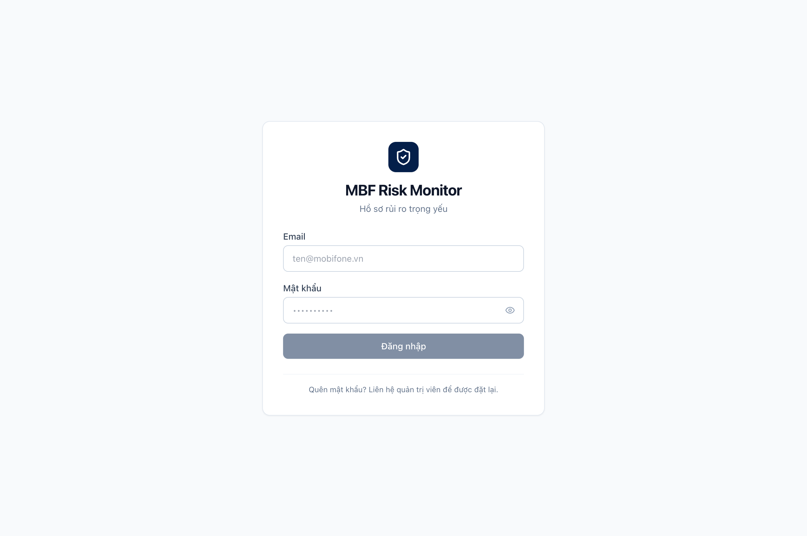

4. **Các bước thao tác**:
   - **Bước 1**: Nhập chính xác địa chỉ Email công vụ MobiFone (ví dụ: `admin@mobifone.vn`, `ban4@mobifone.vn` hoặc `tt1@mobifone.vn`).
   - **Bước 2**: Nhập **Mật khẩu** đăng nhập.
   - **Bước 3**: Nhấn nút **Đăng nhập**.

> [!TIP]
> Nếu bạn đăng nhập lần đầu tiên với mật khẩu tạm do Quản trị viên cấp, hệ thống sẽ tự động chuyển hướng bạn đến màn hình **Đổi mật khẩu** bắt buộc để bảo đảm an toàn thông tin tài khoản.

---

## 1.4. Đổi mật khẩu lần đầu và bảo mật tài khoản

Khi tài khoản được đánh dấu yêu cầu đổi mật khẩu hoặc khi bạn chủ động đổi mật khẩu định kỳ:

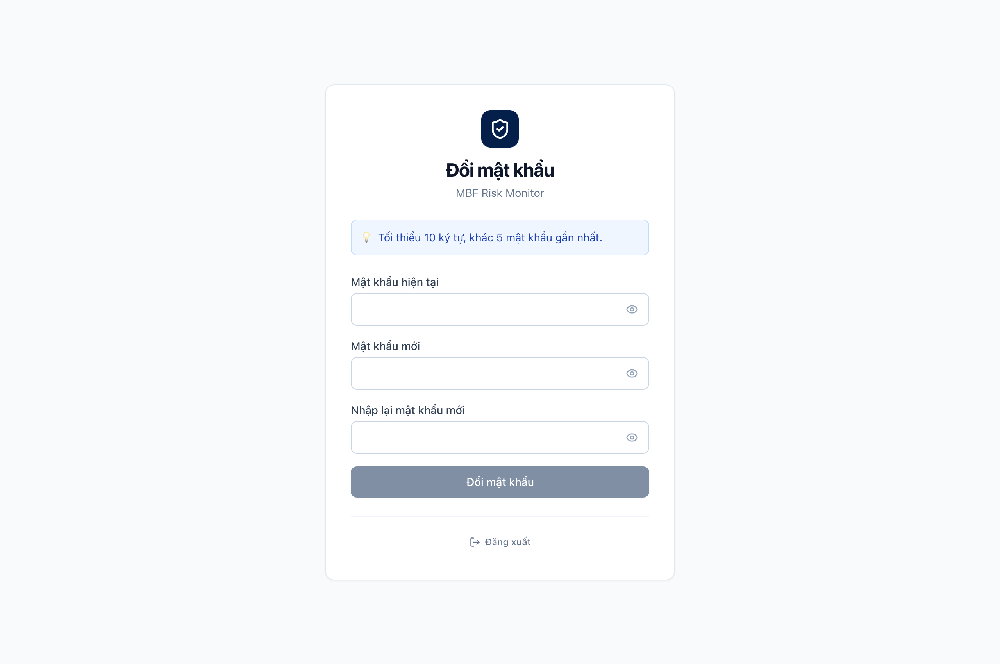

**Quy tắc đặt mật khẩu an toàn theo quy chuẩn MobiFone**:
- Độ dài tối thiểu: **8 ký tự**.
- Phải chứa ít nhất **01 chữ cái viết hoa** (A-Z).
- Phải chứa ít nhất **01 chữ cái viết thường** (a-z).
- Phải chứa ít nhất **01 chữ số** (0-9).
- Phải chứa ít nhất **01 ký tự đặc biệt** (ví dụ: `!`, `@`, `#`, `$`, `%`, `&`, `*`).

**Các bước thực hiện**:
1. Nhập **Mật khẩu hiện tại** (mật khẩu cũ vừa dùng để đăng nhập).
2. Nhập **Mật khẩu mới** thỏa mãn đầy đủ các tiêu chuẩn bảo mật nêu trên.
3. Nhập lại chính xác mật khẩu mới vào ô **Xác nhận mật khẩu mới**.
4. Nhấn nút **Đổi mật khẩu**. Sau khi cập nhật thành công, hệ thống sẽ tự động đưa bạn vào trang Tổng quan.

---

## 1.5. Cấu trúc giao diện chính & Chuyển đổi Chu kỳ năm

Sau khi đăng nhập thành công, giao diện ứng dụng bao gồm các khu vực chức năng chính:

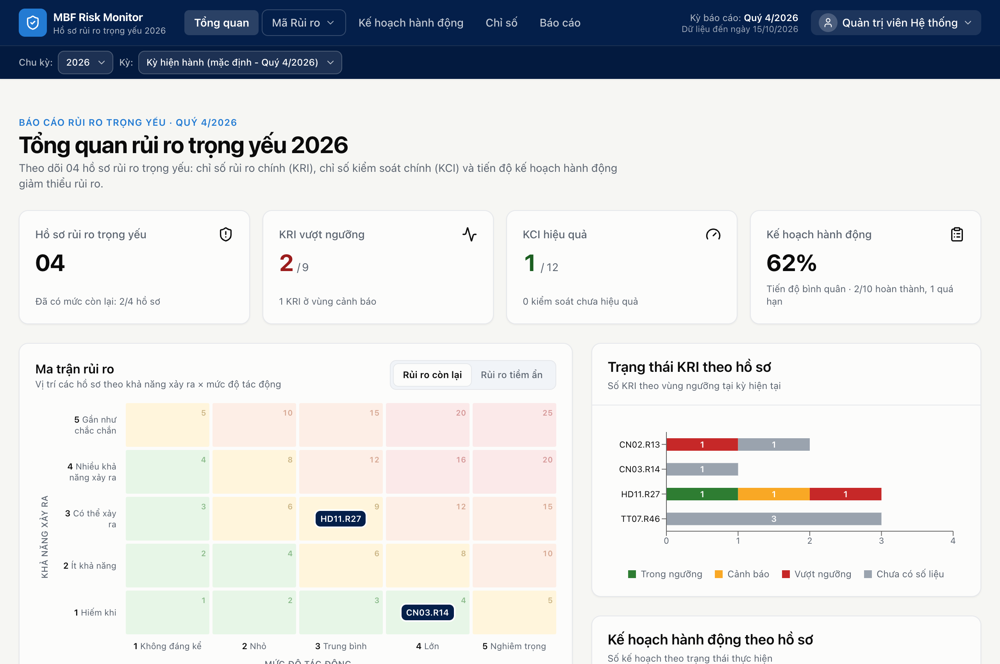

1. **Thanh Header (Đầu trang)**:
   - **Logo MBF Risk Monitor**: Nhấn vào biểu tượng khiên bảo mật để quay về Trang chủ / Tổng quan bất kỳ lúc nào.
   - **Menu Điều hướng chính**: Bao gồm các mục:
     - *Tổng quan*: Màn hình điều hành Dashboard, thống kê KRI, tiến độ kế hoạch và ma trận nhiệt rủi ro 5x5.
     - *Mã rủi ro*: Danh mục menu thả xuống liệt kê nhanh các mã hồ sơ rủi ro trọng yếu (ví dụ: `CN02.R13`, `CN03.R14`, `HD11.R27`, `TT07.R46...`), giúp truy cập trực tiếp vào hồ sơ mà không cần tìm kiếm.
     - *Kế hoạch hành động*: Danh sách và tiến độ tất cả các biện pháp/đầu việc giảm thiểu rủi ro.
     - *Chỉ số*: Toàn bộ danh mục chỉ số KRI và KCI toàn hệ thống.
     - *Báo cáo*: Trang tra cứu báo cáo tổng hợp và xuất biểu mẫu BM06.
   - **Menu Người dùng (Góc phải trên cùng)**: Hiển thị họ tên, vai trò và đơn vị công tác của người dùng. Khi nhấn vào sẽ mở menu xổ xuống:
     - **Chờ duyệt**: Luôn nằm ở dòng đầu tiên của menu, tích hợp huy hiệu số lượng màu cam nổi bật:
       + Đối với `admin` và `ban4`: Hiển thị **tổng số lượng yêu cầu** của tất cả các đơn vị gửi lên đang chờ duyệt.
       + Đối với `unit` (cán bộ đơn vị): Hiển thị **số lượng yêu cầu do đơn vị mình gửi lên** đang chờ duyệt.
     - Các liên kết chức năng Quản trị (dành cho quản trị viên): *Kỳ báo cáo*, *Cấu hình*, *Nhật ký*.
     - *Đăng xuất*: Thoát khỏi phiên làm việc an toàn.
   - **Dải chọn Chu kỳ & Kỳ báo cáo (Hàng thứ hai trên Header)**:
     - **Chu kỳ**: Cho phép chuyển đổi xem dữ liệu giữa các năm (ví dụ: `2026`, `2027`, `2028`). Dữ liệu các năm hoàn toàn độc lập và an toàn.
     - **Kỳ**: Tự động lọc hiển thị các kỳ Quý tương ứng với chu kỳ đang chọn. Khi thay đổi chu kỳ, danh sách kỳ sẽ tự động tải lại mà không cần tải lại toàn bộ trang.

---

# PHẦN II: HƯỚNG DẪN DÀNH CHO CÁN BỘ ĐƠN VỊ (UNIT)

Cán bộ Đơn vị đại diện cho các Ban/Trung tâm có trách nhiệm nhập số liệu định kỳ để báo cáo tình hình kiểm soát rủi ro của đơn vị mình lên Tổng công ty.

## 2.1. Xem danh sách rủi ro và nhiệm vụ thuộc đơn vị phụ trách

Khi đăng nhập với vai trò `unit` (ví dụ: Trung tâm Mạng lưới - TT1):
1. Truy cập trang **Tổng quan**: Hệ thống làm nổi bật các hồ sơ rủi ro mà đơn vị bạn có tham gia thực hiện các biện pháp kiểm soát hoặc kế hoạch hành động.
2. Bấm vào mã hồ sơ (ví dụ `CN02.R13`) để vào trang **Chi tiết Hồ sơ rủi ro**.
3. Tại trang chi tiết, cuộn xuống khối **Kế hoạch hành động** và khối **Chỉ số KRI/KCI**:
   - Các đầu việc hoặc chỉ số do đơn vị bạn phụ trách sẽ hiển thị nút thao tác tương ứng: **"Cập nhật tiến độ"** hoặc **"Nhập số liệu"**.
   - Những mục thuộc trách nhiệm của đơn vị khác sẽ hiển thị ở chế độ chỉ đọc.

---

## 2.2. Nhập số liệu Chỉ số định lượng (KRI/KCI tự động tính vùng)

Chỉ số định lượng là các chỉ số có công thức đo đếm rõ ràng bằng giá trị tỷ lệ phần trăm (%) hoặc số tuyệt đối (ví dụ: Tỷ lệ trễ hạn dự án, Tỷ lệ sự cố mạng lưới).

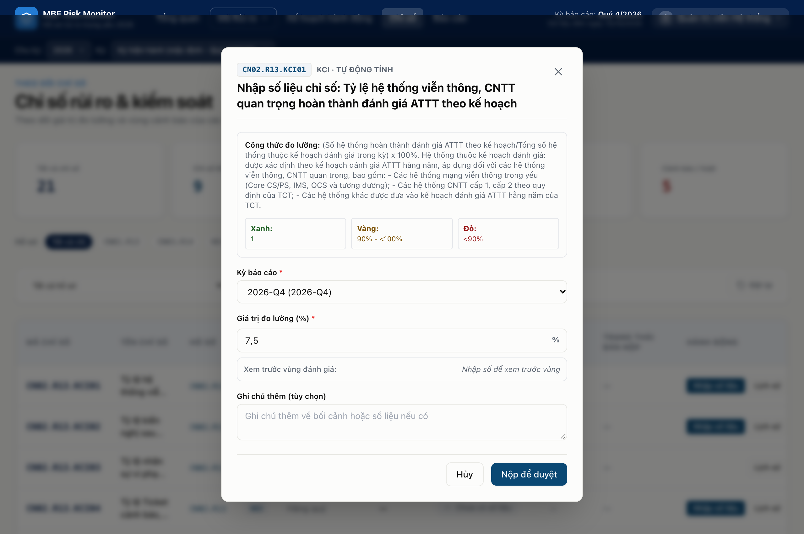

**Các bước thao tác**:
1. Tại danh sách chỉ số, tìm chỉ số cần nhập và nhấn nút **Nhập số liệu**.
2. Hộp thoại nhập liệu mở ra:
   - **Kỳ báo cáo**: Chọn kỳ báo cáo cần nộp (chỉ những kỳ đang mở và chưa khóa mới xuất hiện trong danh sách, ví dụ: `2026-10`).
   - **Giá trị chỉ số (%)**: Nhập con số thực tế đạt được trong kỳ (ví dụ: `7.5`).
3. **Tính năng xem trước vùng rủi ro tự động (Zone Preview)**:
   - Ngay khi bạn nhập giá trị, hệ thống sẽ tự động đối chiếu với ngưỡng quy định và hiển thị ngay huy hiệu phân vùng:
     - ● Vùng Xanh (An toàn): Giá trị nằm trong ngưỡng kiểm soát cho phép.
     - ● Vùng Vàng (Cảnh báo): Bắt đầu có dấu hiệu rủi ro, cần lưu ý theo dõi.
     - ● Vùng Đỏ (Nguy hiểm): Vượt ngưỡng rủi ro cho phép, kích hoạt cảnh báo nghiêm trọng.
4. **Ghi chú**: Nhập diễn giải bổ sung về nguồn gốc số liệu hoặc nguyên nhân biến động (không bắt buộc nhưng khuyến khích).
5. Nhấn nút **Gửi bản nộp**.
6. Hệ thống hiển thị thông báo *“Đã gửi, đang chờ duyệt”* và trạng thái của chỉ số chuyển sang huy hiệu màu tím **Chờ duyệt**.

> [!IMPORTANT]
> **Cảnh báo bản nộp đang chờ duyệt**: Nếu bạn đã gửi một bản nộp cho kỳ này nhưng chưa được duyệt, hệ thống sẽ hiện thông báo cảnh báo và cung cấp nút cho phép **Rút lại bản nộp cũ** nếu bạn muốn gửi số liệu điều chỉnh mới thay thế.

---

## 2.3. Nhập số liệu Chỉ số định tính (KRI/KCI thủ công)

Đối với các chỉ số không đo bằng công thức toán học thuần túy mà đánh giá dựa trên tình hình thực tế (ví dụ: Đánh giá mức độ hoàn thiện quy chế, Mức độ hợp tác của đối tác):

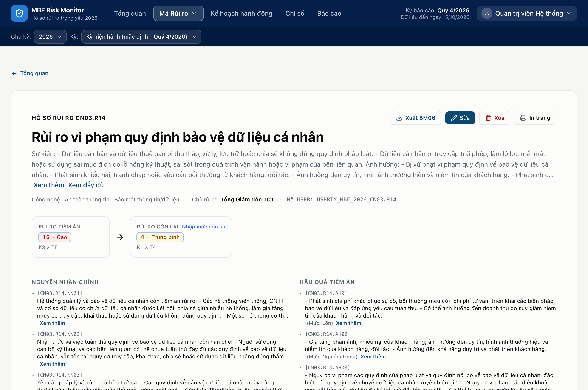

**Các bước thao tác**:
1. Nhấn nút **Nhập số liệu** tại dòng chỉ số thủ công tương ứng.
2. Hộp thoại mở ra hiển thị sẵn tiêu chí ngưỡng đánh giá nguyên gốc từ hồ sơ đã duyệt.
3. **Chọn vùng rủi ro**: Bấm chọn 1 trong 3 nút trực quan:
   - Nút **Xanh** (Tương ứng tiêu chí vùng an toàn).
   - Nút **Vàng** (Tương ứng tiêu chí cảnh báo).
   - Nút **Đỏ** (Tương ứng tiêu chí rủi ro cao).
4. **Mô tả giá trị thực tế**: Nhập vắn tắt hiện trạng công việc tại đơn vị.
5. **Lý do chọn vùng**:
   - Đây là trường **bắt buộc**.
   - Cán bộ phải nhập giải trình rõ ràng với độ dài **tối thiểu 10 ký tự** (ví dụ: *"Đã hoàn thành 85% thủ tục phê duyệt theo đúng quy chế hiện hành"*).
   - Nếu nhập dưới 10 ký tự, hệ thống sẽ cảnh báo và không cho phép gửi.
6. Nhấn nút **Gửi bản nộp**.

---

## 2.4. Cập nhật Tiến độ Đầu việc kế hoạch hành động

Để cập nhật tiến độ triển khai các công việc thuộc kế hoạch ứng phó rủi ro:

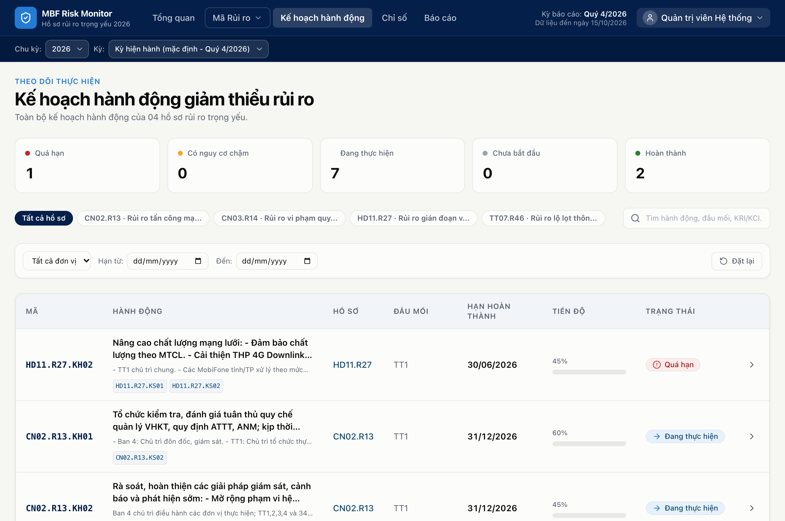

**Các bước thao tác**:
1. Tại trang Chi tiết hồ sơ hoặc trang **Kế hoạch hành động**, tìm đầu việc cần báo cáo và nhấn **Cập nhật tiến độ**.
2. Hộp thoại hiển thị thông tin tiến độ hiện hành (ví dụ: `20%`).
3. **Nhập tiến độ mới**:
   - Sử dụng **Thanh trượt (Slider)** kéo từ `0%` đến `100%`, hoặc gõ trực tiếp giá trị vào ô số bên cạnh.
4. **Quy tắc giải trình khi giảm tiến độ**:
   - Nếu tiến độ bạn nộp **thấp hơn** tiến độ đã được duyệt trước đó (ví dụ từ `40%` điều chỉnh giảm về `30%` do phát sinh vướng mắc nghiệm thu): Ô **Ghi chú giải trình** sẽ chuyển sang trạng thái **Bắt buộc**. Bạn phải nêu rõ lý do điều chỉnh giảm trước khi hệ thống cho phép bấm Gửi.
5. Nhấn nút **Cập nhật tiến độ**. Bản ghi sẽ được chuyển đến hàng chờ duyệt của Ban Quản lý rủi ro.

---

## 2.5. Theo dõi lịch sử, Rút lại bản nộp và Sửa nộp lại bản bị từ chối

### a. Theo dõi lịch sử và Rút lại bản nộp đang chờ:
- Tại mỗi chỉ số hoặc đầu việc, bạn có thể nhấn nút **Lịch sử** để xem toàn bộ quá trình nộp số liệu qua các kỳ.
- Nếu bạn phát hiện nhầm lẫn trong lúc bản nộp đang ở trạng thái **Chờ duyệt**, bạn có thể bấm nút **Rút lại (Withdraw)**. Bản nộp sẽ được hủy bỏ ngay lập tức và bạn có thể gửi lại số liệu chính xác.

### b. Sửa và nộp lại bản bị từ chối:
- Khi Cấp duyệt từ chối bản nộp của đơn vị bạn, huy hiệu sẽ chuyển sang màu đỏ **Bị từ chối**.
- Bạn truy cập vào trang **Chờ duyệt** (`/approvals`) hoặc mở xem chi tiết tại chỉ số:
  - Hệ thống hiển thị rõ ràng **Lý do từ chối** từ Ban Quản lý rủi ro (ví dụ: *"Số liệu chưa khớp với biên bản nghiệm thu quý"*).
  - Xuất hiện nút **Sửa và nộp lại**. Khi bấm vào, toàn bộ dữ liệu bạn đã điền trước đó sẽ được tự động điền lại vào form, giúp bạn chỉ cần sửa đổi điểm chưa chính xác theo ý kiến góp ý rồi bấm gửi lại một cách nhanh chóng.

---

# PHẦN III: HƯỚNG DẪN DÀNH CHO BAN QUẢN LÝ RỦI RO (BAN 4)

Ban Quản lý rủi ro (Ban 4) là đầu mối giám sát, đánh giá và điều phối toàn bộ công tác quản trị rủi ro trọng yếu trên toàn Tổng công ty.

## 3.1. Theo dõi Tổng quan Dashboard và Ma trận nhiệt rủi ro (Heatmap 5x5)

Trang Tổng quan cung cấp bức tranh toàn cảnh về sức khỏe rủi ro của MobiFone:

1. **Các thẻ chỉ số tổng hợp (KPI Cards)**:
   - **Tổng số Hồ sơ rủi ro**: Số lượng rủi ro trọng yếu đang được giám sát trong chu kỳ.
   - **Phân bố Mức rủi ro**: Đếm số rủi ro ở mức Rất cao, Cao, Trung bình, Thấp.
   - **Tình trạng Chỉ số KRI/KCI**: Thống kê số lượng chỉ số đang ở Vùng Xanh, Vàng, Đỏ.
   - **Tiến độ trung bình kế hoạch hành động**: Phần trăm hoàn thành chung của các biện pháp xử lý rủi ro.
2. **Ma trận nhiệt rủi ro 5x5 (Risk Heatmap)**:
   - Trục hoành: **Mức độ Ảnh hưởng** (từ 1 - Không đáng kể đến 5 - Nghiêm trọng).
   - Trục tung: **Khả năng xảy ra** (từ 1 - Hiếm khi đến 5 - Gần như chắc chắn).
   - Mỗi ô trên ma trận hiển thị số lượng hồ sơ rủi ro tương ứng và được tô màu trực quan (Xanh lá, Vàng, Cam, Đỏ).
   - Người dùng có thể nhấn vào từng ô để lọc nhanh danh sách các hồ sơ rủi ro nằm trong phân vùng đó.

---

## 3.2. Giám sát Chi tiết Hồ sơ rủi ro & Thiết lập Ngưỡng, Mục tiêu

Nhấn vào bất kỳ hồ sơ rủi ro nào từ danh sách để vào trang Chi tiết hồ sơ:

Trang chi tiết trình bày cấu trúc phân rã hoàn chỉnh của một rủi ro theo chuẩn mực quốc tế:
- **Thẻ Tóm tắt hồ sơ**: Tên rủi ro, Mã rủi ro (ví dụ `CN02.R13`), Chủ sở hữu rủi ro, Mức rủi ro tiềm tàng (Inherent Risk) và Mức rủi ro còn lại (Residual Risk), nút "Sửa hồ sơ" và "Xuất BM06".
- **Biểu đồ phân bổ trạng thái trực quan**: 
  - Biểu đồ thanh ngang phân bổ trạng thái **Kế hoạch hành động** (Đã hoàn thành, Đang thực hiện, Chưa bắt đầu, Chậm tiến độ...).
  - Biểu đồ thanh ngang phân bổ vùng trạng thái **Chỉ số KRI & KCI** (Vùng Xanh, Vùng Vàng, Vùng Đỏ, Chưa có số liệu).
- **Khối Phân tích Nguyên nhân (Causes)**: Liệt kê các nguyên nhân gốc rễ dẫn tới rủi ro.
- **Khối Đánh giá Ảnh hưởng (Impacts)**: Phân tích tổn thất về tài chính, uy tín thương hiệu, hoạt động vận hành và tính tuân thủ pháp lý.
- **Khối Biện pháp Kiểm soát hiện hữu (Controls)**: Các quy chế, quy trình, rào cản phòng ngừa đang được áp dụng.
- **Khối Kế hoạch Hành động (Action Plans & Tasks)**: Danh mục các nhiệm vụ cụ thể để kéo giảm mức rủi ro, phân bổ đơn vị thực hiện, tiến độ và hạn hoàn thành; hỗ trợ tách đầu việc nhỏ.
- **Khối Chỉ số Cảnh báo sớm (KRI & KCI)**: Bảng theo dõi các chỉ số định lượng/định tính kèm lịch sử biến động qua từng kỳ.

### Tính năng Thiết lập Ngưỡng và Mục tiêu KRI/KCI:

Tại mỗi dòng chỉ số KRI/KCI, cán bộ nhấn vào biểu tượng bánh răng **Cài đặt** để mở Drawer cấu hình:

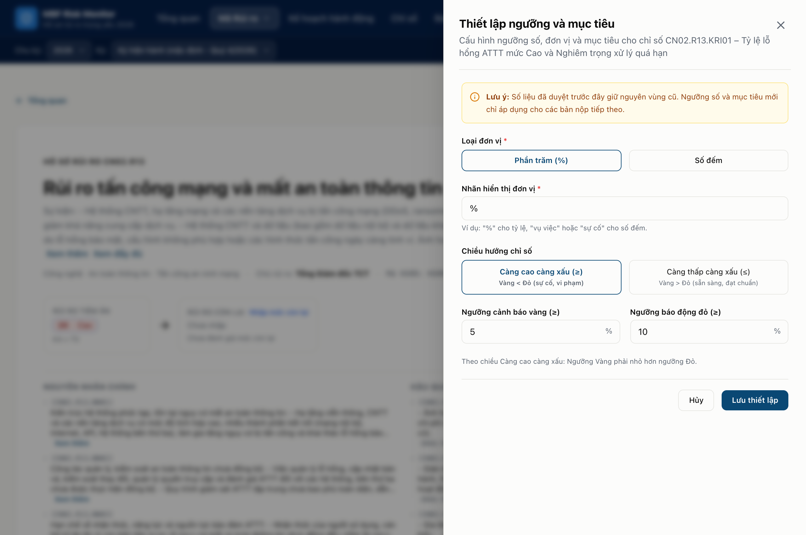

Cán bộ Ban 4 hoặc Quản trị viên có thể tùy biến:
- *Loại đơn vị*: Phần trăm (%), Số lượng, Tiền tệ, Ngày...
- *Nhãn hiển thị đơn vị*: Ký hiệu đo lường (ví dụ: `%`, `vụ việc`, `ngày`).
- *Chiều hướng chỉ số*: **Càng cao càng xấu (≥)** hoặc **Càng thấp càng xấu (≤)**.
- *Ngưỡng cảnh báo Vàng* và *Ngưỡng báo động Đỏ*.
- *Mục tiêu cần đạt* và *Tiến độ hướng tới mục tiêu*.
- Sau khi bấm **Lưu thiết lập**, hệ thống cập nhật tức thì giá trị ngưỡng trên bảng dữ liệu và tự động áp dụng vào thuật toán phân vùng khi đơn vị gửi số liệu.

---

## 3.3. Phân công Đơn vị phụ trách cho Đầu việc và Chỉ số

Để quy trách nhiệm cụ thể cho các đơn vị phòng ban:
1. Mở menu người dùng ở góc phải trên, chọn **Phân công đơn vị** (hoặc truy cập `/admin/assignments`).

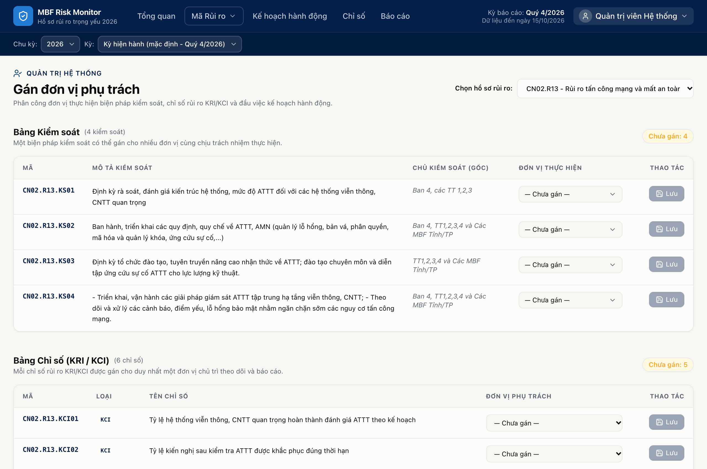

2. Giao diện chia làm 2 tab:
   - **Phân công Đầu việc kế hoạch hành động**: Chọn Đơn vị phụ trách cho từng nhiệm vụ.
   - **Phân công Chỉ số KRI/KCI**: Chọn Đơn vị chịu trách nhiệm nhập số liệu cho từng chỉ số.
3. Thao tác:
   - Tìm kiếm theo mã hoặc tên đầu việc/chỉ số.
   - Tại cột **Đơn vị phụ trách**, bấm vào menu thả xuống và chọn đơn vị mong muốn (ví dụ: `TT1 - Trung tâm Mạng lưới MobiFone miền 1`, `CNTT - Ban Công nghệ Thông tin`).
   - Nhấn nút **Lưu phân công**. Sau khi lưu, chỉ người dùng thuộc đơn vị đó mới có quyền gửi số liệu báo cáo.

---

## 3.4. Theo dõi và Giám sát Hàng chờ duyệt số liệu

Cán bộ Ban 4 có thể theo dõi tiến độ nộp số liệu của các đơn vị trên toàn quốc:
- Nhấn vào **Menu Người dùng** (góc phải trên cùng thanh Header), chọn mục **Chờ duyệt** (dòng đầu tiên có huy hiệu số lượng).
- Theo dõi các đơn vị nào đã nộp, đơn vị nào chậm trễ.
- Xem trước giá trị mới đề xuất so với giá trị hiện hành để đánh giá tính hợp lý trước khi Ban 4 hoặc Quản trị viên tiến hành phê duyệt chính thức.

---

## 3.5. Thực hiện Đánh giá Mức rủi ro còn lại (Residual Risk) theo Quý

Sau khi các biện pháp kiểm soát và kế hoạch hành động đã được triển khai, định kỳ hàng quý Ban Quản lý rủi ro sẽ đánh giá lại mức độ rủi ro còn lại:

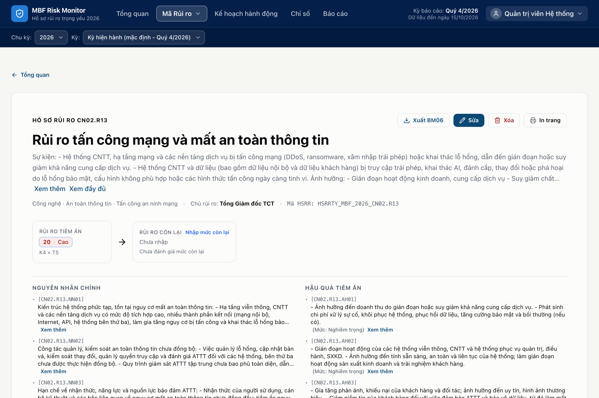

**Các bước thao tác**:
1. Tại trang **Chi tiết hồ sơ rủi ro**, nhấn nút **Đánh giá mức còn lại** trên thẻ tóm tắt.
2. Hộp thoại mở ra:
   - **Kỳ đánh giá**: Chọn kỳ quý tương ứng (ví dụ: `2026-Q4`).
   - **Khả năng xảy ra còn lại**: Chọn thang điểm từ `1` (Rất thấp) đến `5` (Rất cao).
   - **Mức độ ảnh hưởng còn lại**: Chọn thang điểm từ `1` (Không đáng kể) đến `5` (Nghiêm trọng).
   - **Mức rủi ro còn lại kết luận**: Nhập kết luận đánh giá (ví dụ: `Trung bình`, `Cao`).
   - **Ghi chú đánh giá**: Nêu căn cứ đánh giá dựa trên hiệu quả của các biện pháp đã thực hiện trong quý.
3. Nhấn nút **Lưu kết quả đánh giá**.
4. Mức rủi ro còn lại mới sẽ được cập nhật lên thẻ tóm tắt và tự động phản ánh vào các biểu mẫu báo cáo.

---

## 3.6. Xuất Báo cáo Tổng quan và Hồ sơ rủi ro Biểu mẫu BM06

Hệ thống hỗ trợ xuất báo cáo chuẩn hóa để phục vụ các cuộc họp Ban Tổng Giám đốc và Hội đồng thành viên:
1. **Xuất Biểu mẫu BM06 cho từng hồ sơ**:
   - Tại trang chi tiết hồ sơ rủi ro, nhấn nút **Xuất BM06**.
   - Hệ thống tự động tạo tệp Excel `.xlsx` chứa đầy đủ cấu trúc: Thông tin chung, Nguyên nhân, Ảnh hưởng, Kiểm soát, Kế hoạch hành động, Tiến độ và Chỉ số KRI/KCI theo đúng mẫu BM06 quy định của MobiFone.
2. **Xuất Báo cáo Tổng quan**:
   - Truy cập trang **Báo cáo** (`/reports`), nhấn nút **Tải file Excel Tổng quan**. Hệ thống sẽ trích xuất danh mục toàn bộ các rủi ro trọng yếu, kèm trạng thái tiến độ và phân vùng KRI mới nhất.
3. **In ấn A4 chuẩn mực**:
   - Khi cần in hồ sơ ra giấy hoặc xuất tệp PDF, chọn chế độ **Xem bản in** (`?print=1`). Hệ thống tự động tối ưu hóa ẩn các thanh điều hướng, căn lề chuẩn trang A4 và hỗ trợ ngắt trang thông minh.

---

# PHẦN IV: HƯỚNG DẪN DÀNH CHO QUẢN TRỊ VIÊN HỆ THỐNG (ADMIN)

Quản trị viên hệ thống là người có toàn quyền vận hành, thiết lập các tham số, quản lý chu kỳ và kiểm soát an toàn dữ liệu trên MBF Risk Monitor.

## 4.1. Phê duyệt và Từ chối số liệu nộp từ các Đơn vị

Trang **Chờ duyệt** (`/approvals`) là trung tâm xử lý dữ liệu đầu vào:

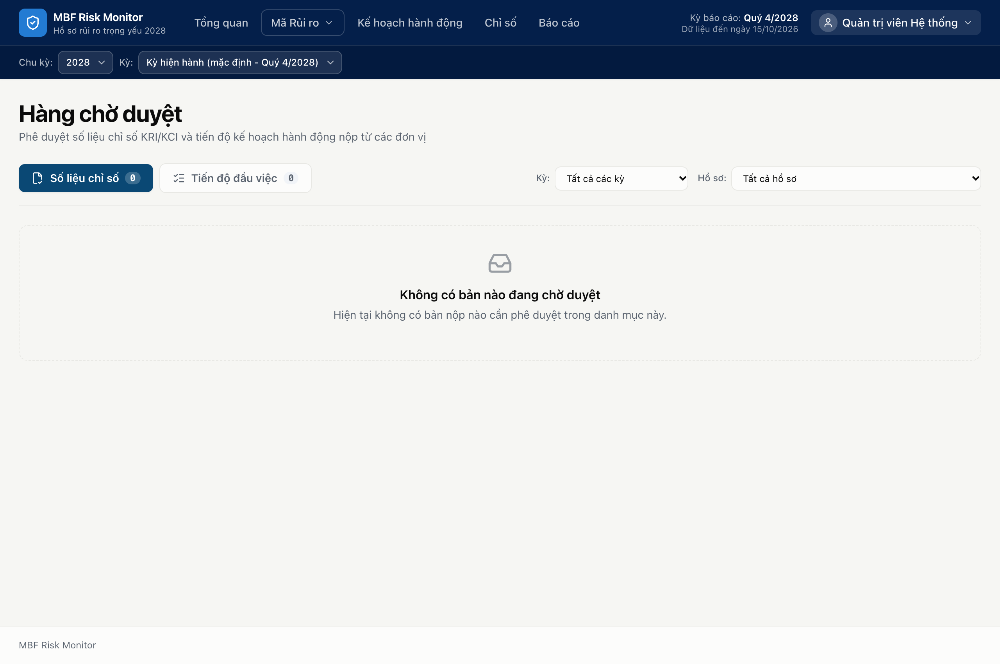

Giao diện được phân tách thành 2 tab nghiệp vụ:
- Tab **"Số liệu chỉ số"**: Chứa các bản nộp giá trị KRI/KCI định lượng và định tính.
- Tab **"Tiến độ đầu việc"**: Chứa các bản cập nhật phần trăm hoàn thành nhiệm vụ.

### a. Thao tác Phê duyệt:
- **Phê duyệt từng mục**: Nhấn nút **Duyệt** ở cột Thao tác tương ứng với dòng dữ liệu.
- **Phê duyệt hàng loạt (Bulk Approve)**:
  - Tích chọn vào ô vuông ở đầu các dòng cần duyệt (hoặc tích chọn ô trên cùng để chọn tất cả).
  - Nhấn nút màu xanh **Duyệt các mục đã chọn**.
  - Sau khi duyệt, giá trị mới sẽ chính thức có hiệu lực và được cập nhật ngay lập tức lên Dashboard Tổng quan và trang Chi tiết rủi ro.

### b. Thao tác Từ chối bản nộp:
- Khi số liệu báo cáo chưa chính xác, thiếu căn cứ hoặc không khớp với thực tế:
  - Nhấn nút **Từ chối** tại dòng dữ liệu cần bác bỏ.
  - Hộp thoại **Từ chối bản nộp** hiển thị:

  - Quản trị viên **bắt buộc phải nhập Lý do từ chối** (độ dài từ 5 đến 500 ký tự) để phản hồi cụ thể cho đơn vị biết cần bổ sung hoặc chỉnh sửa điểm gì.
  - Nhấn nút **Xác nhận từ chối**.
  - Bản nộp chuyển sang trạng thái đỏ `rejected`, đồng thời thông báo lý do từ chối đến tài khoản của đơn vị nộp.

---

## 4.2. Quản trị Chu kỳ rủi ro (Nhập Excel, Sao chép sang năm mới, Lưu trữ)

Truy cập menu Quản trị -> **Quản trị chu kỳ** (`/admin/cycles`):

1. **Nhập chu kỳ từ tệp Excel (Import Cycle)**:
   - Khi bắt đầu một năm công tác mới hoặc thiết lập danh mục rủi ro ban đầu:
   - Nhấn nút **Nhập chu kỳ từ Excel**.
   - Chọn tệp Excel chuẩn mực (ví dụ: `RRTY2026.MBF.xlsx`).
   - Hệ thống tiến hành kiểm tra cấu trúc tệp tin, xác thực các cột, trường bắt buộc và hiển thị bản báo cáo nhập dữ liệu gồm số lượng hồ sơ, nguyên nhân, kiểm soát, hành động, chỉ số đã thêm mới thành công.
2. **Sao chép Chu kỳ sang năm mới (Clone Cycle)**:
   - Khi chuyển giao sang năm kế tiếp mà danh mục rủi ro kế thừa phần lớn từ năm trước:
   - Nhấn nút **Sao chép chu kỳ (Clone)** tại chu kỳ hiện hành.
   - Nhập năm chu kỳ đích (ví dụ: `2027`).
   - Hệ thống tự động nhân bản toàn bộ danh mục hồ sơ, nguyên nhân, ảnh hưởng, kiểm soát, đầu việc và chỉ số sang năm mới, đồng thời đặt lại tiến độ và các bản nộp về trạng thái ban đầu của năm mới. Dữ liệu năm cũ hoàn toàn được bảo lưu nguyên vẹn.
3. **Lưu trữ chu kỳ cũ (Archive Cycle)**:
   - Khi một năm công tác đã hoàn thành công tác kiểm toán và lập báo cáo tài chính:
   - Nhấn nút **Lưu trữ (Archive)**. Chu kỳ đó sẽ chuyển sang trạng thái đóng băng vĩnh viễn (chỉ đọc), ngăn chặn mọi thao tác chỉnh sửa vô ý.

---

## 4.3. Quản trị Kỳ báo cáo (Tạo kỳ tự động, Tạo kỳ đợt, Khóa kỳ, Mở lại kỳ)

Truy cập menu Quản trị -> **Kỳ báo cáo** (`/admin/periods`):

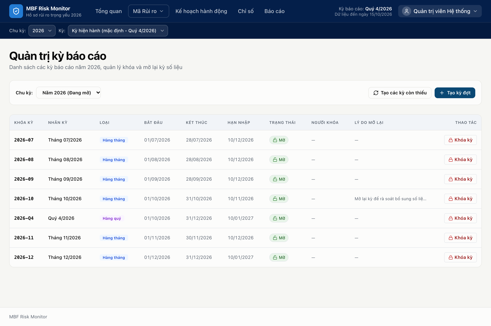

1. **Tạo các kỳ còn thiếu (Ensure Periods)**:
   - Nhấn nút **Tạo các kỳ còn thiếu**: Hệ thống sẽ tự động quét và sinh đủ 12 kỳ tháng định kỳ (`YYYY-01` đến `YYYY-12`) và 4 kỳ quý (`YYYY-Q1` đến `YYYY-Q4`) cho toàn bộ năm công tác.
2. **Tạo kỳ đợt đột xuất (Create Event Period)**:
   - Khi có yêu cầu kiểm tra đột xuất hoặc chiến dịch rà soát ngắn hạn:
   - Nhấn nút **Tạo kỳ đợt**.
   - Nhập **Tên đợt** (ví dụ: *Đợt rà soát an toàn thông tin Q3*), **Ngày bắt đầu** và **Ngày kết thúc**.
   - Bấm **Xác nhận** để kích hoạt kỳ báo cáo đột xuất.
3. **Khóa kỳ báo cáo (Close Period)**:
   - Khi hết hạn nộp số liệu định kỳ:
   - Nhấn nút **Khóa kỳ** tại dòng kỳ tương ứng.
   - **Ràng buộc an toàn**: Nếu trong kỳ vẫn còn bản nộp đang ở trạng thái Chờ duyệt (`pending`), hệ thống sẽ từ chối khóa và thông báo lỗi `INVALID_STATE`, đồng thời cung cấp đường link đưa Quản trị viên sang trang Duyệt để xử lý dứt điểm các bản ghi còn tồn đọng trước khi khóa.
   - Sau khi khóa thành công, kỳ này sẽ không còn xuất hiện trong danh sách nộp số liệu của cán bộ đơn vị.
4. **Mở lại kỳ báo cáo đã khóa (Reopen Period)**:
   - Trong trường hợp đặc biệt cần mở lại kỳ để đơn vị bổ sung giải trình theo kết luận thanh tra:
   - Nhấn nút **Mở lại**.
   - Hộp thoại yêu cầu Quản trị viên **bắt buộc phải nhập Lý do mở lại kỳ**.
   - Nhấn **Xác nhận mở lại**. Hành động này cùng lý do giải trình sẽ được lưu vết vĩnh viễn trong Nhật ký kiểm toán.

---

## 4.4. Quản lý Tài khoản người dùng và Phân quyền

Truy cập menu Quản trị -> **Người dùng** (`/admin/users`):

### a. Thêm người dùng mới đơn lẻ:
- Nhấn nút **Thêm người dùng**:

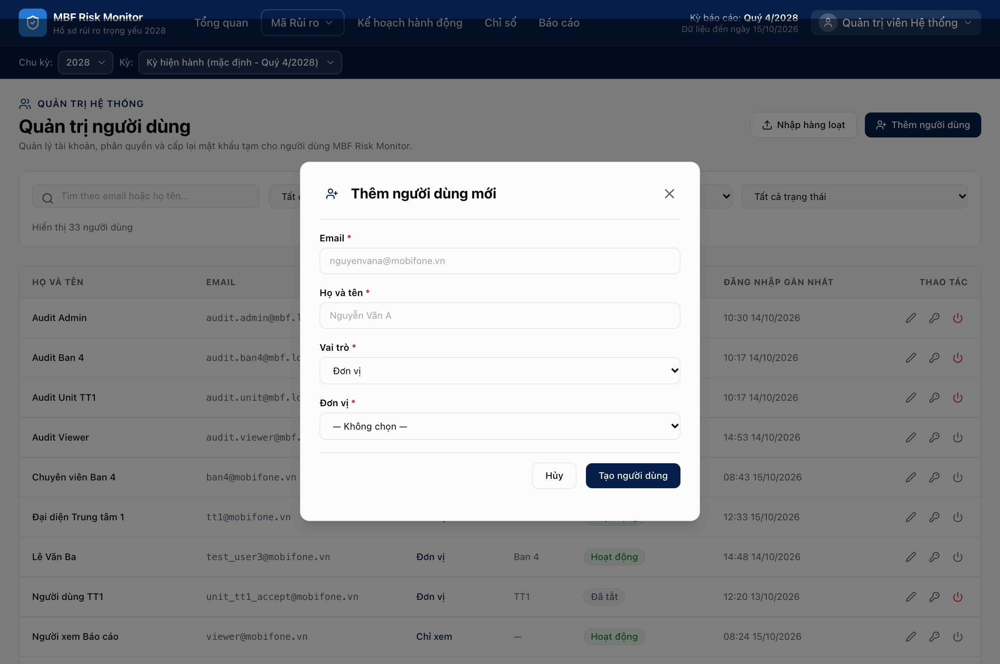

- Điền thông tin:
   - **Địa chỉ Email**: Email công vụ Mobifone (ví dụ: `nguyenvana@mobifone.vn`).
   - **Họ và tên**: Họ tên đầy đủ của cán bộ.
   - **Vai trò**: Chọn 1 trong 4 vai trò (`admin`, `ban4`, `unit`, `viewer`).
   - **Đơn vị trực thuộc**: Chọn Đơn vị mà cán bộ đang công tác (ví dụ: `TT1`, `CNTT`, `TCKT`).
   - **Mật khẩu khởi tạo**: Mật khẩu ban đầu cấp cho cán bộ.
- Nhấn nút **Tạo người dùng**. Tài khoản mới sẽ được thiết lập cờ bắt buộc đổi mật khẩu khi đăng nhập lần đầu.

### b. Nhập người dùng hàng loạt bằng tệp CSV (Bulk Import):
- Khi cần cấp tài khoản cho nhiều cán bộ cùng lúc:
- Nhấn nút **Nhập từ CSV**:

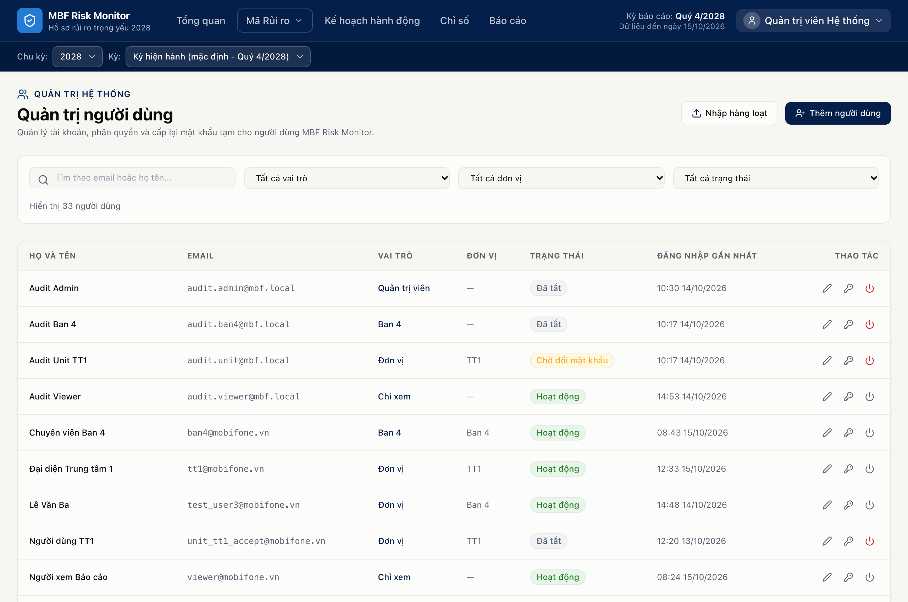

- Bạn có thể nhấn tải **Tệp mẫu CSV** để xem cấu trúc chuẩn gồm các cột: `email,fullName,role,unitCode,password`.
- Chọn tệp CSV đã chuẩn bị từ máy tính và nhấn **Tải lên & Xử lý**. Hệ thống sẽ nhập tự động toàn bộ danh sách và báo cáo kết quả chi tiết.

### c. Đặt lại mật khẩu (Reset Password) & Khóa tài khoản:
- Tại danh sách người dùng, bấm nút menu thao tác tại dòng tương ứng:
  - **Đặt lại mật khẩu**: Cấp mật khẩu mới khi người dùng quên mật khẩu.
  - **Khóa / Kích hoạt tài khoản**: Tạm dừng hoặc khôi phục quyền truy cập của cán bộ.

---

## 4.5. Cấu hình Tham số Cảnh báo hệ thống

Truy cập menu Quản trị -> **Cấu hình** (`/admin/settings`):

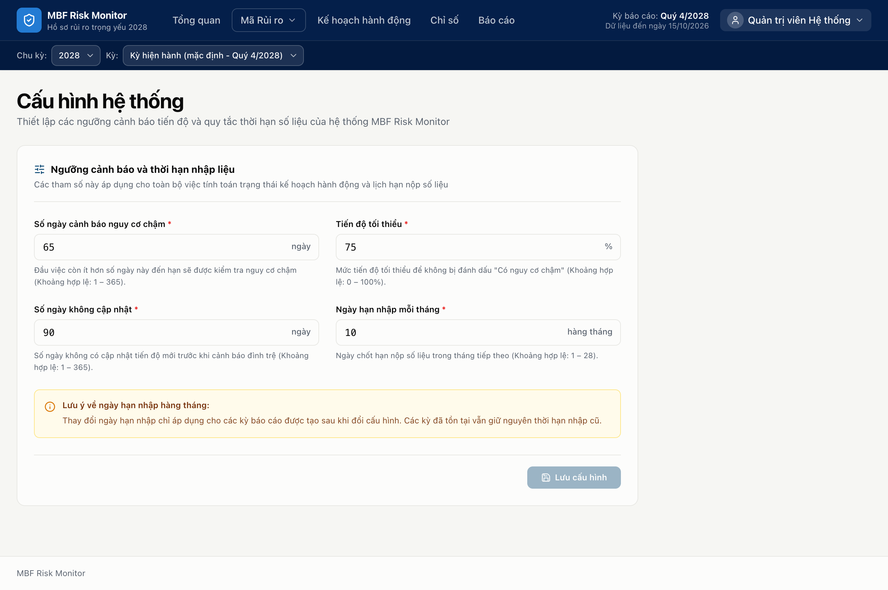

Quản trị viên có thể điều chỉnh 4 thông số vận hành cốt lõi:
1. **Số ngày cảnh báo chậm tiến độ (`risk.slow_days`)**:
   - Khoảng thời gian (ví dụ: `60` ngày). Nếu một đầu việc đã quá số ngày này kể từ ngày bắt đầu mà tiến độ vẫn dưới ngưỡng quy định, hệ thống sẽ kích hoạt cờ cảnh báo Chậm tiến độ.
2. **Ngưỡng phần trăm chậm tiến độ (`risk.slow_progress`)**:
   - Mức tiến độ tối thiểu (ví dụ: `50%`) dùng để so sánh với số ngày trôi qua ở trên.
3. **Số ngày cảnh báo chậm cập nhật chỉ số (`risk.stale_days`)**:
   - Khoảng thời gian (ví dụ: `45` ngày). Nếu một chỉ số KRI/KCI không có bất kỳ bản nộp số liệu nào trong khoảng thời gian này, hệ thống sẽ đánh dấu chỉ số ở trạng thái Quá hạn cập nhật.
4. **Ngày hạn nộp báo cáo hàng tháng (`period.due_day`)**:
   - Ngày trong tháng (ví dụ: ngày `10` hoặc ngày `15` hàng tháng). Là mốc thời gian nhắc nhở các đơn vị hoàn tất việc nộp số liệu định kỳ.

> [!TIP]
> Sau khi điều chỉnh các thông số, nhấn nút **Lưu cấu hình**. Hệ thống sẽ yêu cầu xác nhận trước khi áp dụng trên toàn bộ ứng dụng.

---

## 4.6. Tra cứu Nhật ký kiểm toán (Audit Log) & So sánh Before/After

Truy cập menu Quản trị -> **Nhật ký** (`/admin/audit`):

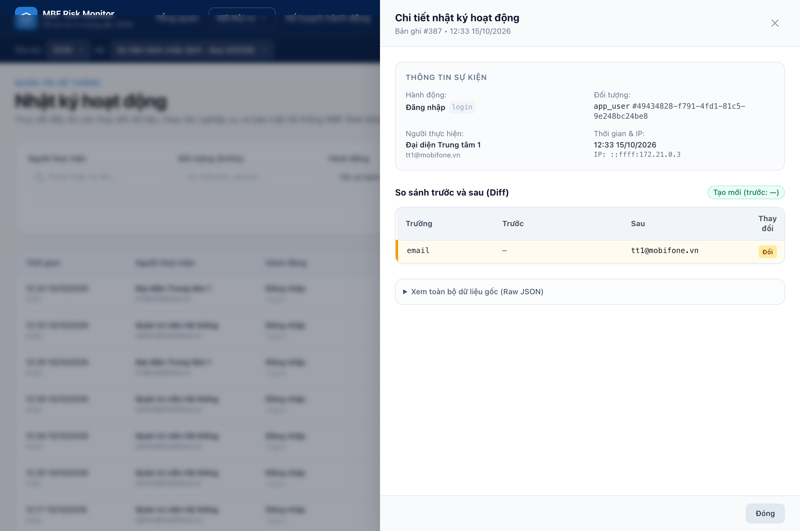

Hệ thống ghi nhận minh bạch và không thể tẩy xóa 100% các thao tác nghiệp vụ:
- **Bộ lọc tìm kiếm thông minh**: Lọc theo Người thực hiện (Actor), Loại đối tượng (Hồ sơ, Chỉ số, Đầu việc, Người dùng,...), Hành động (Đăng nhập, Tạo mới, Chỉnh sửa, Duyệt, Từ chối,...) và Khoảng thời gian.
- **Tính năng So sánh Thay đổi (Before / After Diff)**:
  - Khi bấm vào bất kỳ dòng nhật ký nào, một ngăn chi tiết sẽ mở ra ở bên phải.
  - Hệ thống hiển thị song song hai cột: **Dữ liệu trước thay đổi (Before)** màu đỏ và **Dữ liệu sau thay đổi (After)** màu xanh lá.
  - Các trường thông tin có biến động sẽ được tô màu nổi bật, giúp Quản trị viên và Kiểm toán viên nhanh chóng nắm bắt chính xác ai đã thay đổi nội dung gì, vào thời điểm nào.

---

# PHẦN V: HƯỚNG DẪN DÀNH CHO LÃNH ĐẠO & NGƯỜI XEM (VIEWER)

Dành cho Lãnh đạo Tổng công ty, Trưởng các Ban chức năng và Cán bộ Giám sát:

## 5.1. Tra cứu và theo dõi trạng thái hồ sơ rủi ro toàn Tổng công ty

1. **Xem nhanh tại Trang Tổng quan**:
   - Nắm bắt ngay số lượng rủi ro đang ở mức báo động Đỏ hoặc Vàng.
   - Nhìn vào ma trận Heatmap để biết trọng tâm rủi ro của năm đang nằm ở nhóm nguyên nhân hay lĩnh vực kinh doanh nào.
2. **Tra cứu hồ sơ chi tiết**:
   - Sử dụng ô tìm kiếm để tra cứu nhanh theo Mã rủi ro (ví dụ: `CN02.R13`, `HD11.R27`) hoặc từ khóa trong tên rủi ro.
   - Xem tiến độ triển khai thực tế của các đơn vị thực hiện, tỷ lệ hoàn thành từng đầu việc cụ thể mà không cần phải chờ tổng hợp báo cáo thủ công qua email.

---

## 5.2. Xuất dữ liệu phục vụ họp giao ban và báo cáo điều hành

- Sử dụng tính năng **Xuất Excel Tổng quan** hoặc **Xuất BM06** trực tiếp từ hệ thống.
- Các báo cáo kết xuất luôn đảm bảo tính cập nhật theo thời gian thực, số liệu thống nhất giữa các ban chuyên môn và Tổng công ty, loại bỏ hoàn toàn tình trạng sai lệch số liệu trong các cuộc họp điều hành quan trọng.

---

# PHẦN VI: PHỤ LỤC & GIẢI QUYẾT SỰ CỐ THƯỜNG GẶP (FAQ)

## 6.1. Bảng giải thích thuật ngữ và chữ viết tắt

| Thuật ngữ / Viết tắt | Tên tiếng Anh đầy đủ | Giải thích ý nghĩa nghiệp vụ |
|---|---|---|
| **KRI** | Key Risk Indicator | Chỉ số rủi ro trọng yếu; thước đo dùng để cảnh báo sớm khả năng xuất hiện hoặc gia tăng của một rủi ro cụ thể. |
| **KCI** | Key Control Indicator | Chỉ số kiểm soát trọng yếu; thước đo đánh giá tính hiệu lực và hiệu quả của các biện pháp kiểm soát rủi ro hiện hữu. |
| **BM06** | Biểu mẫu số 06 | Mẫu Hồ sơ rủi ro trọng yếu chuẩn mực theo quy định quản trị rủi ro doanh nghiệp của MobiFone. |
| **Heatmap** | Risk Matrix / Heatmap | Ma trận nhiệt rủi ro 5x5 thể hiện mối tương quan giữa Khả năng xảy ra và Mức độ ảnh hưởng. |
| **Inherent Risk** | Inherent Risk | Rủi ro vốn có; mức độ rủi ro tự nhiên khi chưa áp dụng bất kỳ biện pháp kiểm soát nào. |
| **Residual Risk** | Residual Risk | Mức rủi ro còn lại; mức độ rủi ro sau khi đã thực thi các biện pháp kiểm soát và kế hoạch hành động. |
| **Zone** | Risk Zone | Phân vùng cảnh báo rủi ro gồm 3 mức: Vùng Xanh (An toàn), Vùng Vàng (Cảnh báo), Vùng Đỏ (Nguy hiểm). |
| **Unit** | Department / Unit | Đơn vị phụ trách thực hiện; các Ban chức năng, Trung tâm hoặc Chi nhánh trực thuộc Tổng công ty. |
| **Ban 4** | Risk Management Dept | Ban Quản lý rủi ro - đơn vị chuyên trách đầu mối quản trị rủi ro của MobiFone. |

---

## 6.2. Câu hỏi thường gặp và cách xử lý

### Câu hỏi 1: Tại sao tôi không nhìn thấy nút "Nhập số liệu" hoặc "Cập nhật tiến độ"?
- **Nguyên nhân 1**: Bạn chưa được phân công phụ trách đầu việc hoặc chỉ số đó. Vui lòng kiểm tra lại đơn vị tài khoản của bạn hoặc liên hệ Ban 4 để được gán quyền phụ trách.
- **Nguyên nhân 2**: Kỳ báo cáo hiện tại đã bị Quản trị viên Khóa (`closed`). Khi kỳ đã khóa, hệ thống sẽ ẩn nút nhập liệu để đảm bảo toàn vẹn số liệu lưu trữ.

### Câu hỏi 2: Tôi nộp nhầm số liệu thì phải làm thế nào?
- Nếu bản nộp đang ở trạng thái **Chờ duyệt** (màu tím): Bạn bấm nút **Lịch sử** tại chỉ số/đầu việc đó và nhấn nút **Rút lại (Withdraw)**. Sau khi rút lại, bạn có thể thực hiện nộp lại số liệu mới.
- Nếu bản nộp **Đã được phê duyệt**: Bạn không thể tự ý sửa. Bạn cần liên hệ Quản trị viên hoặc Ban 4 để yêu cầu từ chối hoặc điều chỉnh lại kỳ báo cáo.

### Câu hỏi 3: Tại sao Quản trị viên không thể bấm nút Khóa một kỳ báo cáo?
- **Nguyên nhân**: Trong kỳ báo cáo đó hiện vẫn còn tồn tại các bản nộp chỉ số hoặc đầu việc đang ở trạng thái **Chờ duyệt** (`pending`).
- **Cách xử lý**: Quản trị viên truy cập trang **Chờ duyệt** (`/approvals`), lọc theo đúng kỳ báo cáo đó, tiến hành Phê duyệt hoặc Từ chối toàn bộ các bản ghi còn tồn đọng. Sau khi hàng chờ của kỳ về số 0, bạn sẽ khóa kỳ thành công.

### Câu hỏi 4: Tôi quên mật khẩu đăng nhập thì phải làm sao?
- Bạn vui lòng liên hệ Cán bộ Quản trị hệ thống (Admin). Quản trị viên sẽ sử dụng tính năng **Đặt lại mật khẩu (Reset password)** trong menu Quản trị Người dùng để cấp cho bạn mật khẩu tạm thời. Khi đăng nhập bằng mật khẩu tạm, bạn sẽ đổi lại mật khẩu mới của riêng mình.

### Câu hỏi 5: Tại sao khi chọn chu kỳ các năm tương lai (ví dụ 2027, 2028), các kỳ quý không có nút "Nhập số liệu" hay "Cập nhật tiến độ"?
- **Nguyên tắc nghiệp vụ**: Theo quy chế quản lý rủi ro của Tổng công ty, hệ thống áp dụng quy tắc chặt chẽ: **Không cho phép nộp số liệu cho các kỳ chưa bắt đầu** (ngày bắt đầu kỳ > ngày hiện tại).
- Do thời điểm hiện hành của hệ thống là năm 2026, tất cả các kỳ Quý của năm 2027 trở đi đều chưa đến thời điểm bắt đầu. Vì vậy, hệ thống tự động ẩn nút nộp số liệu để tránh việc nhập liệu sớm không đúng quy định. Khi bước vào năm công tác 2027 và kỳ quý đó bắt đầu, các nút thao tác sẽ tự động hiển thị để cán bộ thực hiện báo cáo.

---

## 6.3. Kênh liên hệ hỗ trợ kỹ thuật

Trong quá trình sử dụng hệ thống MBF Risk Monitor, nếu gặp bất kỳ khó khăn hoặc sự cố kỹ thuật nào cần hỗ trợ, xin vui lòng liên hệ:
- **Đơn vị quản lý nghiệp vụ**: Ban Quản lý rủi ro (Ban 4) - Tổng công ty Viễn thông MobiFone.
- **Đầu mối hỗ trợ kỹ thuật**: Tổ Quản trị Hệ thống MBF Risk Monitor.
- **Email hỗ trợ**: `riskmonitor-support@mobifone.vn`
- **Địa chỉ trụ sở**: Tòa nhà MobiFone, Lô VP1, Phường Yên Hòa, Quận Cầu Giấy, Thành phố Hà Nội.

---
*MBF Risk Monitor - Nền tảng số hóa quản trị rủi ro chuyên nghiệp, minh bạch và hiệu quả.*
